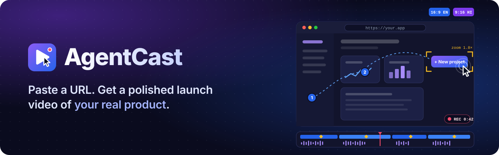
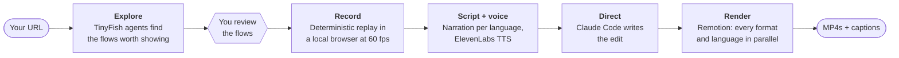

<p align="center">
  
</p>

<p align="center">
  <b>The future of SaaS videos and explainers.</b><br>
  An autonomous agent uses your product on the live web, records the best flows,<br>
  and edits them into a finished video. No screen recorder. No manual editing.
</p>

<p align="center">
  
  
  
  
  
</p>

---

## Why

Every product needs a demo video for launches, landing pages, investor pitches, app stores, onboarding and hackathon submissions. Making one is slow, and it goes out of date the moment the UI changes:

- **Recording is manual.** You set up test accounts, script the flow and retake every misclick.
- **Editing is manual.** Zooms, cursor smoothing, captions, voiceover and music all get added by hand.
- **Every variant is extra work.** 16:9 vs 9:16, desktop vs mobile, English vs Hindi each mean another recording or edit.
- **Videos go stale.** Every UI change makes the demo outdated, so most teams ship old demos or none at all.

AI video generators can't help, because they generate footage instead of showing your real product. AgentCast uses the real product.

## How it works



1. **Explore.** TinyFish web agents open your product, sign in, work through onboarding and try candidate flows in parallel. Each flow is scored on how clearly it shows your product's value, and the best 3–4 are ordered into a story.
2. **Record.** A Playwright script replays the approved flows in a local browser while capturing the screen over CDP at 60 fps. TinyFish cloud browsers are the fallback for sites that block a local browser. It only clicks an element when exactly one match exists, checks that each step did what it should, and throws away any take that goes wrong. The exploring agent's hesitation never reaches the footage.
3. **Script and voice.** Narration is written per segment, natively in each language, and voiced with ElevenLabs using word-level timestamps.
4. **Direct.** Claude Code, running headless in a sandbox, writes the edit: smart zoom on every click, a smooth cursor, captions, music ducked under the voice, and a branded intro and outro.
5. **Render.** Remotion renders every variant in parallel. Each language is retimed to fit its own voiceover, so the product is recorded once and narrated many times.

When your UI changes, `rerun` reuses the approved flows, repairs broken element lookups, and regenerates the video in minutes. It can run from CI.

## Features

| | |
|---|---|
| 🔗 **URL in, video out** | No setup beyond a link and an optional one-time sign-in |
| 🎬 **Real footage only** | Every product pixel comes from a real browser session. Overlays annotate, they never fabricate. |
| 🧭 **Finds the flows itself** | Parallel agents propose and test flows, and a scoring rubric picks the ones that show value |
| 🎯 **Clean takes** | Semantic element targets, outcome checks and automatic retakes mean no misclicks on camera |
| 🌐 **Variants from one run** | 16:9 and 9:16, desktop and mobile, English and Hindi |
| 🙋 **Human in the loop** | Review the flows, the script and a preview you can revise with a prompt. Autopilot skips all three. |
| 🔁 **Re-run on update** | Cached flows and self-healing locators regenerate the video after a UI change |
| 🔐 **Secrets stay secret** | Credentials go from TinyFish Vault or your own sign-in straight to the browser, never into a prompt |
| 🧩 **Bring your own coding agent** | No LLM API key needed. Uses your logged-in Claude Code (default) or Codex CLI; opencode is planned. |

## DemoBoard target

The controlled demo SaaS lives in [`apps/demoboard`](apps/demoboard/README.md) and deploys independently to Vercel. It includes sign-in, project templates, simulated content generation, editable drafts, analytics, and downloadable reports. No API keys or AgentCast worker are needed. Run `npm --prefix apps/demoboard ci`, then `npm --prefix apps/demoboard run dev` and open **http://localhost:3001**. Its README includes the deployment button and three recording flows.

## Use cases

- **Product launches:** a polished demo for Product Hunt, X and your landing page, from just a URL.
- **Always-current demos:** re-render on every release so the website never shows an outdated UI.
- **Help-center tutorials:** "How to do X" videos per feature, refreshed when the UI changes.
- **Multilingual marketing:** the same tour in English and Hindi, for YouTube and for Reels/Shorts.
- **Sales and investor demos:** walkthroughs focused on what a specific prospect cares about.
- **Hackathon submissions:** cut demo-video time from hours to minutes.
- **Public-service walkthroughs:** step-by-step Hindi tutorials for confusing public portals.

## Status

AgentCast is being built for **HackIIIT 2026** (IIIT Delhi) in the TinyFish-sponsored track. The pipeline above is the design. Here's what exists today:

- [ ] Product requirements and phased implementation plan
- [ ] Monorepo scaffold (pnpm, TypeScript strict, Vitest)
- [ ] `packages/shared`: zod schemas for every pipeline artifact
- [ ] `packages/llm`: LLM runner with Claude Code and Codex backends
- [ ] `agentcast doctor`: environment and LLM-login checks
- [ ] UI design agreed ([DESIGN.md](DESIGN.md)) and the web app started: a chat-style New video page that asks setup questions one at a time
- [ ] Spikes: CDP recording from TinyFish browsers, agent step quality, sign-in once, Remotion, Hindi TTS
- [ ] Worker and orchestrator with a live-progress UI
- [ ] Explore, record, script, voice, direct, render
- [ ] Variant fan-out, re-run on update, CLI and GitHub Action

## Getting started

**You need:**
- Node.js 22+ and pnpm
- ffmpeg
- A logged-in coding-agent CLI: Claude Code (the default) or Codex CLI 0.163+. **No LLM API key is required.**
- A [TinyFish](https://tinyfish.ai) API key and an [ElevenLabs](https://elevenlabs.io) API key (the current scaffold runs without them)

```bash
git clone <this repo> agentcast && cd agentcast
pnpm install
cp .env.example .env              # add TINYFISH_API_KEY and ELEVENLABS_API_KEY
pnpm agentcast doctor --probe     # checks tools and keys, and makes one tiny call through your coding agent
```

`doctor` shows which coding agent each tier will use:

```
✓ LLM: claude-code       2.1.302 (Claude Code)
✓ LLM smart tier         → claude-code
✓ LLM fast tier          → claude-code
✓ LLM probe (fast tier)  ok=true in 3.3s
```

To use Codex, run `codex login` and set `AGENTCAST_LLM=codex` in `.env`. Leave
`AGENTCAST_LLM_SMART` and `AGENTCAST_LLM_FAST` empty so both tiers use Codex. Then run
`pnpm agentcast doctor --probe`, followed by `pnpm dev:worker` and `pnpm dev:web` in separate terminals.
Restart a running worker after changing `.env`.

Codex uses its built-in default model unless `AGENTCAST_LLM_SMART_MODEL` or
`AGENTCAST_LLM_FAST_MODEL` is set to a Codex model available to your account. Clear any
Claude-specific `opus`/`haiku` overrides when switching. The runner ignores Codex user settings,
plugins and MCP servers, supplies task files and screenshots itself, and disables shell access.
The director edits the workspace with `apply_patch`; the worker validates each edit and sends
errors back to the same Codex session for repairs and revisions.

### Development

```bash
pnpm typecheck    # tsc in every package
pnpm test         # vitest; LLM adapter tests use a fake CLI and spend no quota
```

## Project layout

```
packages/
  shared/    zod schemas: flows, replay plan, timeline, script, edit plan (EDL), jobs, events
  llm/       backend-agnostic LLM runner (Claude Code and Codex; opencode and API planned)
  cli/       `agentcast` command (doctor today; run / rerun planned)
apps/
  web/       Next.js app: chat-style New video page (pnpm dev:web)
assets/brand/  logo and banner
```

Planned: `apps/worker` (orchestrator), `apps/demoboard` (demo target app), and `packages/tinyfish`, `recorder`, `director`, `voice`, `video`.

## Documentation

| Doc | What's in it |
|---|---|
| [PRD.md](PRD.md) | Problem, requirements, architecture, TinyFish integration, data contracts, risks |
| [IMPLEMENTATION_PLAN.md](IMPLEMENTATION_PLAN.md) | Phases, spikes, schedule, cut-line, testing strategy |
| [DESIGN.md](DESIGN.md) | The agreed UI: palette, type, components, screens, landing page |
| [AGENTS.md](AGENTS.md) | Instructions for coding agents working on this repo (Claude Code reads it via `CLAUDE.md`) |

## Built with

- [**TinyFish**](https://tinyfish.ai): Agent, Fetch, Vault and Browser Context Profiles, with the Browser API as the fallback recorder. The location scouts that find and rehearse every shot.
- [**Claude Code**](https://docs.claude.com/en/docs/claude-code): headless and sandboxed. The director.
- [**Remotion**](https://www.remotion.dev): the editing suite.
- [**ElevenLabs**](https://elevenlabs.io): multilingual voiceover.
- [**Playwright**](https://playwright.dev): deterministic replay over CDP.

<br>
<p align="center">
  <br>
</p>
